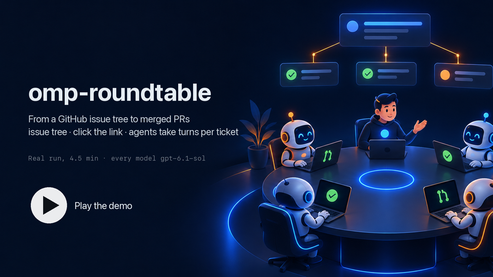

# omp-dispatch

Dispatch delivers GitHub issue graphs through durable tickets that move along a configurable workflow state machine, with source-confirmed effects, one-shot seat sessions, and fresh independent judges. Main chooses which independent tickets run concurrently and which dependency edges enforce serial delivery; the workflow decides what happens to each ticket on the way.

## Demo

[](https://cdn.jsdelivr.net/gh/oh-my-omp/omp-dispatch@main/docs/demo/dispatch-demo.mp4)

A 4½-minute walkthrough of one real take, every model on `openai-codex/gpt-6.1-sol`. It starts with an omp session filing a feature as an issue tree: parent [#190](https://github.com/RiriAgent/rt-e2e-20260930-0931/issues/190) with native sub-issues [#186](https://github.com/RiriAgent/rt-e2e-20260930-0931/issues/186) and [#187](https://github.com/RiriAgent/rt-e2e-20260930-0931/issues/187), which are independent, [#188](https://github.com/RiriAgent/rt-e2e-20260930-0931/issues/188) with `Depends on #186`, and [#189](https://github.com/RiriAgent/rt-e2e-20260930-0931/issues/189) with `Depends on #187` and `Depends on #188`; the parent ends with the coordinator link. A click on that link on GitHub reaches the local launcher, which opens a Tern tab running the coordinator for `RiriAgent/rt-e2e-20260930-0931#190`. Main's terminal then plays beside a ticket graph and a seat timeline drawn from the run's agenda state file and seat session logs. Every ticket passes between separate sessions: an Owner, review and accept side by side, Dispatch's own merge, then a post-merge check; the video stops on #186's relay with each seat's agent, session and duration. #186 and #187 start together, #188 starts the moment #186 is Done while #187 is still in review, and #189 waits for the later of its two dependencies; PRs #191–#194 merge and #190 closes. The video pauses and zooms at each of those moments; idle time is cut, the issue authoring plays at 6×, Main's activity at 2× and seat-only stretches at 12×.

## Starting a coordinator

A coordinator starts from the issue it delivers, never from a switch inside a session. The issue carries one link:

```
http://127.0.0.1:47591/<owner>/<repo>/issues/<number>?spec=<percent-encoded JSON>
```

`spec` is one JSON object, `{"cwd": "<absolute local checkout>", "frontend": {"kind": "<frontend>", ...}}`. `cwd` is where the coordinator runs; `frontend` names where its process runs, and every field besides `kind` belongs to that frontend. Unknown fields at either level are refused, so a frontend's options extend the link without changing its path or query grammar. The only frontend today is `{"kind": "tern"}`, which takes no options.

GitHub strips inline `<svg>` from issue bodies, so the link is written as this repository's badge image wrapped in the link, not as a bare URL. The JSON is percent-encoded as a query value; a raw space or parenthesis would end the Markdown link. For `cwd` `/Users/me/src/repo` with Tern:

```markdown
[](http://127.0.0.1:47591/<owner>/<repo>/issues/<number>?spec=%7B%22cwd%22%3A%22%2FUsers%2Fme%2Fsrc%2Frepo%22%2C%22frontend%22%3A%7B%22kind%22%3A%22tern%22%7D%7D)
```

Install the extension as an omp plugin (`omp plugin install omp-dispatch`), then install the launcher once — from any omp session with `/dispatch-launcher install`, or from the package CLI with `omp-dispatch-launcher install`. `install` writes `~/Library/LaunchAgents/com.ohmyomp.dispatch-launcher.plist` and leaves `127.0.0.1:47591` answering; `uninstall` removes it and `status` reports it together with the GitHub App and its webhook listener.

The launcher holds no state of its own. It reads the link, calls the named frontend, and returns one page naming exactly one outcome: `launched` (the frontend now runs `omp --dispatch <owner>/<repo>#<number>` in `cwd`), `existing` (the frontend already runs a coordinator for that exact reference and started nothing), `rejected` (malformed path or number, a missing, malformed or unknown `spec`, a `cwd` that is not an existing absolute directory, or a request that is not a user's click navigation), or `frontendFailed` (the frontend's own output). Only `Sec-Fetch-Mode: navigate` with `Sec-Fetch-User: ?1` is served, because any page can GET `127.0.0.1` and GitHub drops Referer on the https→http hop; the click is the operator's authorization. The port and the `spec` grammar are part of the published link contract.

The Tern frontend opens a tab running the coordinator, or focuses the live block that already runs that exact reference. Tern's daemon outlives its window, so it opens a window in `cwd` first whenever no window client is connected: a block started without one would run invisibly.

### GitHub App trigger

The launcher can also start a coordinator without a click, when a GitHub App delivers an `issues` event. Register the App once with `omp-dispatch-launcher github-app register --webhook-url <https URL> [--org <organization>] [--name <app name>]` (or `/dispatch-launcher github-app register ...`). It opens GitHub's App manifest flow in the browser; after you confirm, GitHub's one-time code is converted into the App's credentials, written to `~/.config/omp-dispatch/github-app.json` with mode `0600`. The App asks for read access to issues and subscribes to `issues` events. Install it on the repositories whose issues may start a coordinator. Registering again replaces the file with a new App's credentials.

The webhook listener runs inside the launcher on `webhookHost:webhookPort` (default `127.0.0.1:47592`) and serves only `POST /github/webhook`, accepting a delivery only when its `X-Hub-Signature-256` matches the App's webhook secret. It is a separate port from the link listener so that exposing it never exposes the click endpoint, whose header check a non-browser client could forge. The plugin does not provide that exposure: route your own HTTPS tunnel or reverse proxy to the listener, and pass its public URL as `--webhook-url`.

A delivery starts a coordinator on the event that makes the trigger condition true, through the frontend and `cwd` of the link in the issue body; an issue without a valid link for itself never starts one. The condition needs an open issue whose author association is allowed, plus:

| `githubTrigger` | Condition | Events that can make it true |
|---|---|---|
| `link` (default) | the body carries a valid launcher link for this issue | `opened`, `reopened`, `edited` when the edit adds the link |
| `label` | the link, and a label from `githubTriggerLabels` (any label when empty) | the above, and `labeled` when the added label is the first match |

`githubTriggerAssociations` (default `OWNER,MEMBER,COLLABORATOR`) lists the issue author associations GitHub reports that may start a coordinator; it describes the issue's author, not who labeled or edited it. The trigger settings and the App credentials are read on every delivery; `webhookHost` and `webhookPort` are read when the launcher starts, so changing them needs `install` again. Configure them like any plugin setting, for example `omp plugin config set omp-dispatch githubTrigger label`. The launcher reads the user-level plugin settings, not a project's `plugin-overrides.json`. Every delivery is answered with its decision once made (`launching`, `ignored` with the reason, or a rejection) and logged to the launcher's log; the frontend launch continues after the answer.

## The coordinator

`--dispatch` is the whole identity. From `session_start`, the process's Main coordinates that issue and keeps the same native session throughout delivery. One visible startup message identifies the issue and any saved active agenda. Main reads the issue and its sub-issues, then calls the `dispatch` tool with a strict `{"input": ...}` object. Ending a coordinator means ending its omp process.

Without the flag the extension registers nothing else: no active `dispatch` tool, no timers, no dispatch state.

Main starts a new agenda with `convene`, supplying `parent` (or `null`) and `tickets`. Every ticket entry has an `id`, `issue`, `target`, `dependsOn` array, and `adoptPr` reference or `null`. All current parent sub-issues must be represented. Dependencies refer to ticket IDs; independent tickets have no edge. Main can change the topology and record exceptional rulings with `resolve`. A saved active agenda is taken over with `resume` and its `agenda` id alone.

An attached agenda records its coordinator process: the pid and the start time the operating system reports for it (`ps -o lstart`). A coordinator that exits normally writes the agenda back to detached. `resume` asks the operating system about the recorded pid: only a process with that pid and the same start time is the previous coordinator, so a crashed or killed coordinator, or a pid since reused by another process, does not block it. While the previous coordinator still runs, `resume` refuses with `agenda_attached`, naming its pid and start time, and the agenda stays with that process. The agenda state lives on this host, so the check covers coordinators on this host only.

## Workflow

Every ticket, and the parent closure once every ticket is delivered, moves through a state machine defined by the workflow. The workflow decides which states exist, what each one does, the condition for entering it, and where each outcome leads. Code fixes only what a state kind does and the source checks no workflow can switch off. The built-in workflow is [`src/default-workflow.yml`](src/default-workflow.yml). It runs `Coding → Publishing → AwaitingChecks → Reviewing → Merging → Verifying → Closing → Done`: the Owner uses the packaged `dispatch-owner` agent; `review` and `accept` on the PR, `postMerge` on the merge commit, and `closure` on the parent use the packaged `dispatch-reviewer` agent. Installing this plugin supplies both agents without omp-config. Failing CI, a conflict, or a rejected review returns the ticket to `Coding`.

Neither packaged agent specifies a model. The host uses the current session model by default; bind models independently in the native `task.agentModelOverrides` setting, for example:

```json
{
  "task": {
    "agentModelOverrides": {
      "dispatch-owner": "provider/owner-model",
      "dispatch-reviewer": "provider/reviewer-model"
    }
  }
}
```

Use valid model selectors from your host. To use other native agents, copy the built-in workflow to your own workflow file, change its `agent` names to agents discoverable in the coordinator's workspace, and select that file with `workflowFile` below. A workflow's duties (`brief`) remain separate from the agent's base responsibilities.

| Kind | What it does | Outcomes |
|---|---|---|
| `work` | seats one `role` with its `agent` and `brief`; the seat pushes a branch and calls `submit`; a later seat of the same role forks that role's session | `submitted`, `escalated` |
| `judge` | seats every listed judge on a `subject`: `pullRequest` (the exact PR head) or `mergeCommit` (the exact merge commit); parent judges check out the first ticket's target branch | `passed` (every judge passed; an empty list passes at once), `rejected` (any judge failed), `escalated` |
| `action` | performs one GitHub write and waits for GitHub to confirm it: `publishPr`, `merge`, `closeIssue`, `rerunChecks` (every failing Actions run of the PR; with none it escalates); parent: `closeParent` | `done` |
| `decision` | moves to the first branch whose condition holds, re-checked on every refresh; an unconditional last branch `{to}` is its fallback, and without one it waits | its branch targets |
| `final` | delivered | none |

An outcome leads to a state, to `escalate` (Main's ruling, the `Escalated` state), or to a branch list `[{when, to}, ..., {to}]` whose first matching branch wins and whose last entry is the fallback. Any state may declare an entry condition `when` with a fallback `otherwise`: whichever outcome or ruling targets the state, the ticket enters it only while `when` holds, and goes to `otherwise` instead. Conditions read only source-confirmed facts and the machine's own history: `{checks: passing|failing|pending|unknown}`, `{mergeable: 'yes'|'no'|behind|draft|unknown}` (quote `yes` and `no` in YAML), `{visits: {state, atLeast}}` for how often a state was entered, and `{all}`, `{any}`, `{not}`. The parent machine has no PR, so it uses only `visits` and the combinators. A `pullRequest` judge, a `merge` action, and a ticket decision may declare `observe`. While the ticket holds an open PR in that state, `checksFailed`, `conflict`, `behind`, and `drift` (a new head, title, or description) lead where `observe` says, and to `escalate` when it says nothing. A PR that is closed, retargeted, a draft, or no longer closes exactly its issue, and checks that cannot be read, always escalate.

`ticket.initial` is the work state a convened ticket starts in, and the state Main launches. A ticket convened with `adoptPr` starts in `ticket.adopted.pullRequest` when the PR is open and in `ticket.adopted.mergeCommit` when it is already merged; it has not visited the initial state. `parent.initial` is entered once every ticket is delivered, and again whenever the delivered children change.

This workflow adds a security judge that runs only on the first round, routes a security rejection to Main instead of back to rework, and verifies the merge only for reworked tickets:

```yaml
ticket:
  initial: Build
  adopted: {pullRequest: WaitCi, mergeCommit: Close}
  states:
    Build: {kind: work, role: builder, agent: dispatch-owner, brief: Deliver the issue., on: {submitted: Open, escalated: escalate}}
    Open: {kind: action, action: publishPr, on: {done: WaitCi}}
    WaitCi:
      kind: decision
      branches: [{when: {all: [{checks: passing}, {mergeable: 'yes'}]}, to: Security}]
      observe: {checksFailed: Build, conflict: Build, behind: Build, drift: WaitCi}
    Security:
      kind: judge
      subject: pullRequest
      when: {not: {visits: {state: Build, atLeast: 2}}}
      otherwise: Quality
      judges: [{role: security, agent: dispatch-reviewer, brief: Check for injection and leaked secrets.}]
      observe: {checksFailed: Build, conflict: Build, behind: Build, drift: WaitCi}
      on: {passed: Quality, rejected: escalate, escalated: escalate}
    Quality:
      kind: judge
      subject: pullRequest
      judges: [{role: quality, agent: dispatch-reviewer, brief: Check correctness and tests.}]
      observe: {checksFailed: Build, conflict: Build, behind: Build, drift: WaitCi}
      on: {passed: Ship, rejected: Build, escalated: escalate}
    Ship:
      kind: action
      action: merge
      requires: [Quality]
      observe: {checksFailed: Build, conflict: Build, behind: Build}
      on: {done: [{when: {visits: {state: Build, atLeast: 2}}, to: Deploy}, {to: Close}]}
    Deploy: {kind: judge, subject: mergeCommit, judges: [{role: deploy, agent: dispatch-reviewer, brief: Verify the merged change.}], on: {passed: Close, rejected: escalate, escalated: escalate}}
    Close: {kind: action, action: closeIssue, on: {done: Delivered}}
    Delivered: {kind: final}
parent:
  initial: Release
  states:
    Release: {kind: judge, judges: [{role: release, agent: dispatch-reviewer, brief: Verify the parent is delivered.}, {role: compliance, agent: dispatch-reviewer, brief: Check the delivery against the release policy.}], on: {passed: CloseParent, rejected: escalate, escalated: escalate}}
    CloseParent: {kind: action, action: closeParent, requires: [Release], on: {done: Finished}}
    Finished: {kind: final}
```

- **Merging:** `merge` waits until the PR is mergeable with passing required checks and every dependency is delivered. It then needs a passed approval, on the current PR fingerprint, from every judge state named in `requires` and from every PR judge state the ticket still holds. A drift drops all PR approvals.
- **Closing:** `closeIssue` needs a Main `noCode` ruling on the current contract, or a merge still contained in the target with its `requires` approvals. `closeParent` needs the current children fingerprint with its approvals.
- **Final states:** a ticket stays in a final state only while its issue is closed and its merge or `noCode` ruling still holds. The parent closure stays in one only while the parent issue is closed and its children are the ones judged. Otherwise they escalate. Dependencies, the parent closure, and `finish` count a ticket as delivered when it rests in a final state.
- **Main's override:** these source checks bind Main's `resolve` too, but judge states do not. Main may resolve a ticket or the closure into a later state, including a final one, without its judges once the source facts hold; that is an explicit ruling, recorded on the ticket.
- **Failures:** a judge state that did not pass keeps no approval. A GitHub write that fails or has an unknown outcome always escalates to Main.
- **Revisions:** every state entry starts a new ticket revision, so a seat of the previous entry is superseded. A state that completes at once, such as an empty judge list or a matching decision, moves on immediately. A machine that passes 64 states without waiting escalates as a loop.

The loader refuses unknown fields, unknown targets, unreachable states, cycles of entry fallbacks, an initial state that is not an unguarded `work` state, a machine without a final state, a parent condition that reads the PR, a judge role used twice or shared with a work role, a work role with two agents, a `requires` naming the wrong kind of judge, a missing outcome, and the reserved names `escalate`, `Escalated` and `Asking`. Role and state names start with a letter and use letters, digits, `_`, or `-`. A `brief` is the seat's duty. Dispatch adds the protocol to it: ticket scope, what the checkout is, the exact `submit` or `verdict` call, and that the workflow decides what follows. An `agent` is a native agent name, resolved the way `task` resolves it in the coordinator's `cwd`, and must be non-blocking.

`convene` reads the current `omp-dispatch` plugin setting `workflowFile`, relative to the coordinator's `cwd`; an explicitly selected file must exist. `OMP_DISPATCH_WORKFLOW` takes precedence. Configure the global value with `/settings` → Plugins → omp-dispatch or `omp plugin config set omp-dispatch workflowFile ./workflow.yml`. Configure a project in `.omp/plugin-overrides.json`:

```json
{
  "settings": {
    "omp-dispatch": {
      "workflowFile": "./workflow.yml"
    }
  }
}
```

When neither the environment nor plugin setting selects a file, `convene` reads `<dispatch.dataDir>/workflow.yml`, falling back to the built-in workflow when the file does not exist. An unreadable or invalid file, an empty/non-string setting, or an agent that cannot host a seat refuses `convene`. The agenda freezes the workflow it was convened with: relays, rework, and `resume` never read the file again, so edits apply to the next `convene`. The `dispatch.dataDir`, `dispatch.recomputeIntervalSeconds` and `dispatch.pmConfigDir` settings use the native settings mechanism.

## Interface language

Notifications, command help, and the launcher CLI and HTML use English or Chinese. On each text generation, language is resolved from normalized `OMOMP_LANG=en|zh`, then the first nonempty `LC_ALL`, `LC_MESSAGES`, or `LANG` (`zh` prefix means Chinese), then English. The agent-directory omomp files never participate in language resolution. Model-facing tool descriptions, results, workflow briefs, and coordinator instructions stay English. Runtime notifications show a localized error category and point to the log for the full structured protocol diagnostic.

## Ticket handoff

Main decides only when each ticket is launched. `status` returns the agenda, including its workflow, with the `launchable` tickets (never launched, neither `Escalated` nor delivered, every dependency delivered), the `asking` tickets (each with its worker's question and the id of its `ask` comment once GitHub shows it, see [PM integration](#pm-integration)), and the seats currently `seated`. Main calls `launch` with `ticketId` and an optional `role`, once per ticket; an omitted `role` means the ticket's currently executable seats, and a given `role` must be one of them. The call marks the ticket started, seats its current state at once, and returns their native async job IDs, so independent tickets can be launched back to back. From then on Dispatch follows the workflow by itself: it seats each work and judge state, performs each action, and evaluates each decision, including the parent machine once every ticket is delivered. A seat is one-shot per revision: a role seated at a revision is never seated at that revision again within the process, so a seat that ends without a handoff is followed by its escalation, not by a replacement. A work seat starts only after every seat of its ticket has exited. Native `task` is not used for these seats because its session allocator cannot accept a work-session fork manager.

Main is woken by a `dispatch-attention` message only for a decision it has not yet been told about and that is still open when its current turn ends: a ticket that became launchable, an `Escalated` ticket or closure (keyed by revision), a failed PM effect (`failed:<ticket>:<effect>`, see [PM integration](#pm-integration)), or a finished agenda awaiting `finish`. A decision Main settles within the turn that produced it, such as launching what `convene` unlocked, never wakes it again. Launching, running seats, seat job completions, a ticket waiting in `Asking`, and effects in flight do not notify.

Each seat reads only its bound ticket through `read`. A work seat pushes its code branch and calls `submit` with the ticket revision, branch, head, title, and a PR body closing exactly that issue. A judge calls `verdict` with its own `role`; findings land on the ticket's notes. A seat calls `escalate` for a question, blocker, proposed split, or no-code finding, which follows its state's `escalated` outcome; only a `question` may carry a `tier` (`simple` or `complex`). With PM integration on, a work seat's question goes to the intent guardians instead (see [PM integration](#pm-integration)). A successful handoff ends the seat; it does not wait for another assignment.

A seat that ends at its current revision without a handoff, or cannot be started, escalates its ticket instead of being relaunched. Main handles `Escalated` tickets, and records exceptional rulings on any other ticket or the closure, with `resolve`, naming the state to continue in with `to` (a parent workflow state for the closure). A resolution starts a new revision, so the seats of the state it replaces are superseded. `resolve` records a persistent ruling, synchronizes the issue contract, adjusts topology, adopts source results, or settles a failed or uncertain effect. `retry` adopts the effect if GitHub already shows it. Otherwise a PM record (`comment`, `setProjectField`) is queued again under the same effect and sent once more, and any other effect is cancelled: resolving to its action state requests it afresh. A `publishPr` or `rerunChecks` can be retried that way directly. A `merge` or `closeIssue` cannot: the ruling changes the fingerprint its judges approved, so it has to go back through those judge states. The target is entered through its entry condition, and `resolve` is refused when that entry escalates, for example a `merge` state without the approvals it requires, or a final state whose issue is still open. Main confirms no-code work with `noCode` and a `to` whose entry lands in a `closeIssue` action state or a final state; the ticket is delivered only after GitHub confirms the closure. `resolve` may queue only `replaceBody`, `createIssue`, `attachChild`, and `rerunChecks` for a ticket, and nothing for the closure; publishing, merging, and closing belong to the workflow's action states. A started ticket resumes its relay from the named state. A changed `target` drops the ticket's work sessions, so the next work seat checks out the new target. `finish` records the final summary only after every ticket and the parent closure rest in a final state. A parent final state also needs the parent issue closed.

## Sessions and recovery

Every seat checkout is a detached `git worktree` of a per-repository bare cache under `<dispatch.dataDir>/repos`, which is cloned once and fetched before each checkout; seats never clone from the network. Worktrees live under `<dispatch.dataDir>/worktrees/<agendaId>`. A work role's first seat receives a new persistent native session and a checkout of the target branch; the ticket records that role's accepted session in `sessions`. A later seat of the role forks it with `SessionManager.forkFrom` in the same checkout, repairing an interrupted transcript tail and resetting inherited cost, then gives that manager to `createAgentSession`. A role's first seat records its base system prompt and its tool presentation (enabled tools and the subset mounted as `xd://` devices) in a `dispatch-session-contract` entry. The fork restores both and explicitly inherits the provider prompt-cache key. It clears the inherited todo list and appends only the incremental notes and rulings to the new turn. A fork source whose contract lacks the tool presentation cannot be forked, so its ticket escalates. Actual provider cache hits still depend on the provider; preserving a key is not a measured hit-rate guarantee.

Every seat is a full native omp session in its checkout, not a restricted one. It binds the extensions Main loaded (user plugins, configured extensions, and their extension roots), reads the workspace's settings, discovers the workspace's custom tools, shares Main's MCP servers, and keeps every tool those provide, including `todo`, `task`, and replacements such as `exec_command` for `bash`. Its seat agent may delegate to helper agents (`spawns` follows the agent definition, `*` when unspecified). Only the seat's own session is bound to its ticket: the `dispatch` tool it receives reads and hands off that ticket, while helpers it spawns have their own native identities and are refused as seats. Seats run headless, so tool approvals are not prompted, and they never join IRC: a seat reaches Main only through its ticket. Extensions bind from Main's process rather than being rediscovered, so project-local extensions or MCP servers of a different target repository are not loaded into its seats.

Judge seats always receive new blank sessions; their histories are never reused or forked. `pullRequest` judges check out exactly the PR head their gate stamp names (fetched through the PR's pull ref, so fork heads work), `mergeCommit` judges check out exactly the merge commit, and parent judges check out the first ticket's target branch; the host verifies the checkout's `HEAD` before the seat starts. A parent judge's brief carries the closure record (its children's issues, terminals and targets, rulings and notes), not the parent or child issue bodies, and its checkout covers only that one target even when the children span several. A superseded seat ends at its next native tool-completion boundary instead of retrying another revision's work; accepted handoffs finish normally so their checkpoints remain intact. `mergeCommit` fingerprints pin the ticket's merge commit and freshly verify target containment, so unrelated forward merges do not invalidate a running verification. Seat sessions are disposed when their native async jobs finish. Work checkouts survive process restarts and rework until `finish`; judge worktrees are removed when their jobs end. Session files remain under `<dispatch.dataDir>/sessions/<agendaId>`.

Accepted transitions and effect intents are durably saved under `<dispatch.dataDir>/state` before returning. Every external GitHub write first persists `executing`, performs the operation, then confirms its result through a fresh GitHub read. An unknown outcome becomes `uncertain` and is never automatically resent. Resume reconciles interrupted executing GitHub writes against GitHub rather than replaying them. A failed or uncertain workflow effect escalates its ticket. PM record effects (`comment`, `setProjectField`) never escalate their ticket or supersede its seats, because they are written while a work seat may still be running: an uncertain one is confirmed by the next complete GitHub read that shows it and turns failed when that read does not, and a failed one keeps its error text, wakes Main with `failed:<ticket>:<effect>`, and blocks `finish` until Main settles it through `resolve` (`retry` sends the same record again unless GitHub already shows it, `adopt` takes what GitHub shows, `cancel` drops it; resolving to a work state seats a new work session, which writes its own marker and, if needed, the Status again, and resolving to `Done` requests the done Status again). A re-sent record is idempotent by its marker key or field value: the executor confirms one GitHub already shows instead of writing it twice. A request to the intent guardians (`requestAnswer`) is the one effect confirmed by its own answer rather than a GitHub read, because the guardians accept a repeat of it: a connection error or any answer other than 202 or 200 fails it with that text, never leaves it uncertain, and does not escalate the ticket, and a request a restart interrupted is sent again on resume. Every effect records the state entry that requested it. A ready effect is cancelled once that entry is left, and a late confirmation records its result without moving a newer state. PR head, target, issue contract, PR body, or ruling changes invalidate approvals before any merge.

State envelopes use `format: 9`, which carries the agenda's frozen workflow in file shape, the attached coordinator's pid and start time, and each `Asking` ticket's question. Older formats are rejected without migration or deletion. State saves sync the owned state directory, not its ancestors. The extension never rewrites conversation history or injects per-turn hidden ticket context; ticket reads and visible notifications are ordinary messages.

## PM integration

`dispatch.pmConfigDir` (environment `OMP_DISPATCH_PM_CONFIG`, empty by default) names the root of a PM configuration repository, resolved against the coordinator working directory. Empty leaves PM integration off: Dispatch reads no PM file, writes no PM comment or Project field, and asks no intent guardians. When it is set, the coordinator reads three YAML files at startup. A missing file, a missing key, a value of the wrong type, or a key the file does not define refuses to start the coordinator; the notification lists every problem as `<file>: <key path>: <problem>`.

- `shared/repos.yaml`: `pm` (`repo` as `owner/name`, `project` with `owner` and `number`), `code` (a list of `repo` and local `cwd`), `design` (a list of `owner/name`), and `omp` (a list of `owner/name`).
- `shared/project.yaml`: `fields` with `status` (`name`, `options` `todo`, `inProgress`, `done`, `superseded`), `kind` (`name`, `options` `human`, `agenda`, `implementation`), `agenda` (`name`), and `proposer` (`name`, `options` `human`, `guardians`, `coordination`). Names are the Project's field and option names; node ids are looked up by name.
- `dispatch/delivery.yaml`: `guardiansURL` (an `http` or `https` URL), `defaultTier` (`simple` or `complex`), `tierHelp`, and `resumePrompt`.

[`tests/sim/pm-config`](tests/sim/pm-config) is a complete example. With PM integration on, every work seat that starts, fresh or forked for rework, leaves one comment on its ticket's issue whose last line is the `impl` marker `<!-- pm:impl {"v":1,"host":…,"pid":…,"agenda":…,"session":…,"file":…} -->`: the host name and process id of the coordinator, the agenda id, and the seat's native session id and session file. When a work seat starts while the issue's item in the configured Project does not show the `inProgress` Status option, the item moves to it (the issue is added to the Project if it has no item there); when the ticket enters the final state `Done`, it moves to the `done` option. Both writes are effects like the workflow's own: each is persisted before it is sent and counts as done only when a fresh GitHub read shows a comment with that marker kind and session, or that Status option. Issue reads then also return every comment that ends in a `pm:` marker (`impl`, `ask`, `reply`, `replaced`, `escalated`, each with `"v":1` and all fields of its kind) and the issue's Project item; a malformed marker is logged and ignored.

A work seat's question is the other PM path. When an Owner calls `escalate` with kind `question`, the ticket enters the built-in state `Asking` instead of its state's `escalated` outcome: it gets a new revision, seats nobody, and does not wake Main. Its `ask` records the question, the tier (the one the seat gave, else `defaultTier`), the asking session's id and file, and the id of its `ask` comment. Dispatch stops the asking session right after the handoff, so its transcript ends with that abort and no further assistant message. The question is then written verbatim to the issue as a comment whose last line is `<!-- pm:ask {"v":1,"tier":…,"session":…} -->`, one per asking session. Once GitHub shows that comment, its id is recorded and the intent guardians at `guardiansURL` receive `POST /v1/asks` with `{"issue":"owner/repo#n","comment":<id>,"question":…,"tier":…}`. A failed request wakes Main with `failed:<ticket>:<effect>` and leaves the ticket `Asking`. `resolve` can still move an `Asking` ticket to any workflow state, which drops its question. A work seat's brief under PM integration explains the tier with `tierHelp` and says that asking ends the session. A blocker, split or no-code finding, a judge's question, and every escalation with PM integration off still go to Main as `Escalated`.

## State-flow simulation

`bun run sim [scenario...]` runs the real `omp` binary in RPC mode with this extension, its controller, seat host, git worktrees, native sessions and forks. Only the model, GitHub and the intent guardians are simulated: `tests/sim/extension.ts` registers a scripted `sim` provider that plays Main and every seat from what omp actually sends it, `tests/sim/github-sim.ts` answers the real `src/ports/github.ts` through a `gh` shim placed first on `PATH`, backed by local bare repositories for every git fact and failing loudly on any request it does not model, and `tests/sim/ask.ts` serves a local `POST /v1/asks` that records each request and answers 202 for a new comment and 200 for a repeat. Each scenario supplies its workflow as `<dispatch.dataDir>/workflow.yml`, with every seat agent defined as a scripted agent; all but `flow` use the built-in workflow. Scenarios run in scratch directories under `/tmp/dispatch-sim-*` and need no network:

- `tree`: seven tickets with parallel, serial, gate rejection with forked rework, escalation with a ruling, noCode through `Closing`, and the parent closure. Every seat must record `task` and `dispatch` with `spawns` `*`, and each rework fork must keep its first Owner's prompt-cache key and clear the inherited todo list. `tree-pm` runs the same delivery with PM integration on, using `tests/sim/pm-config`, and also checks that every Owner session, rework forks included, left exactly one `impl` marker naming its session, session file, host and agenda, and that every ticket's Project Status went `In Progress`, then `Done`.
- `ci`: required checks that stay pending hold the ticket in `AwaitingChecks`; a failing check returns it to `Coding` for a forked rework.
- `head`: a new head pushed to an open PR while both judges are seated restarts review on the new head without escalating.
- `abandon`: an Owner that ends without a handoff escalates once and is seated again only after Main's ruling.
- `restart`: the process is killed while a handed-off Owner is mid-tool, and the workflow file is rewritten to a different roster; after `resume`, the agenda keeps its frozen workflow, and the rework fork repairs the interrupted tail and resets inherited cost.
- `restart-pm`: with PM integration on, the simulated GitHub holds the rework Owner's `impl` comment request and the process is killed once the hold is reached, in three branches. `restart-pm/arrived` records the comment before the kill and loses only its response: after `resume` the comment effect is confirmed against GitHub without escalating the ticket, a ruling, or a `failed:` notification. `restart-pm/lost` and `restart-pm/dropped` kill before the comment is recorded: after `resume` the effect is `failed`, Main is woken with `failed:<ticket>:<effect>`, and `finish` is refused until Main's `resolve` with `retry`. In `lost` the killed process's request then reaches GitHub, so the retry adopts it as confirmed without sending it again. In `dropped` the request never reaches GitHub, so the retry sends the comment again and it is confirmed on its second attempt. In every branch the agenda completes, the resumed Owner forks the accepted session, and each of the three Owner sessions has exactly one `impl` marker and one recorded comment request. `bun run sim restart-pm` runs all three branches.
- `flow`: the custom workflow above with scripted agents, over three tickets and a parent. `F1` passes `Security` and `Quality` and goes straight to `Close`. `F2` is rejected by `Quality`, reworks, skips `Security` on its entry condition, and passes `Deploy` on the post-merge branch. `F3` is rejected by `Security` and goes straight to Main, which resolves it to `Build`. Every seat runs its configured agent and carries only its own duty, and the parent machine finishes through both `Release` judges.
- `ask`: with PM integration on, the only Owner asks a `complex` question. Its ticket ends `Asking` naming the question, tier, Owner session and file, and comment id; the issue carries the `impl` comment, then exactly one `ask` comment holding the question verbatim; the Owner transcript ends at the accepted escalate with the guardians abort; the guardians receive one request for that comment, answered 202; and Main is never woken.
- `ask-restart`: the same question, but the guardians hold their first answer and the process is killed while the request is executing. After `resume` the request is sent again and answered 200, with still one `ask` comment, one request effect confirmed on its second attempt, the ticket `Asking`, and no Owner relaunched.
- `ask-unreachable`: the question carries no tier, so `defaultTier` applies, and nothing listens at `guardiansURL`. The request fails with the connection error text, Main is woken with `failed:A:<effect>`, and the ticket stays `Asking` without a new Owner.

Each delivery scenario also checks that Main launched every ticket exactly once, was never woken for a decision it had already taken, that every expected judge's accepted verdict sat on the exact commit its subject names, and that the simulated repository ends in the expected state. A scenario without PM integration also checks that no issue carries a `pm:` comment and the Project has no item.
